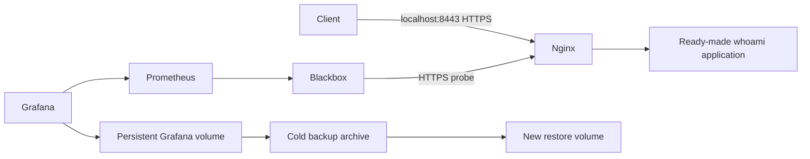

# Linux / Docker Infrastructure Demo

Self-initiated infrastructure portfolio lab. No custom application development: the ready-made `traefik/whoami` service is deployed behind Nginx with local HTTPS, Prometheus/Blackbox availability checks, and Grafana. Includes cold backup and restore scripts for Grafana state.

**Validation status: PASS — 27 October 2026.** The lab was started on Docker Desktop (Linux/arm64). Acceptance checks verified certificate-validating HTTPS, healthy monitoring, detection of a controlled application stop, recovery after restart, a Grafana cold backup, restoration into a separate new Docker volume, preservation of the saved dashboard and its verification marker, authenticated access after restoration, and return to the original volume. Evidence: `evidence/acceptance.json`. This validates the local lab only; it does not validate or reproduce the retired GCP/GKE environments.

Image tags are explicit historical versions for reproducibility, not a claim of current security patch status; review and update before real use.

## Architecture



## Start

Requirements: Docker Desktop on macOS/Windows or Docker Engine with Compose v2 on Linux, OpenSSL, curl. Run from this directory:

```sh
sh scripts/init.sh
docker compose config --quiet
docker compose up -d
docker compose ps
sh scripts/verify.sh
```

Allow images to download and services to initialize. Repeat verification when ready. Blackbox needs at least two scrape intervals (about 30 seconds). HTTPS is at https://localhost:8443. The certificate is self-signed for this local lab. Use the included CA with curl as in verify.sh; do not disable TLS validation or install this demo CA system-wide.

Grafana: http://localhost:3001, user `admin`, password in local `.env`. Prometheus: http://localhost:9091. All published ports bind to loopback. Unpublished services remain on the Compose network. This is a local lab, not a production security baseline.

In Grafana, create and **save** a dashboard called `Restore proof` with a panel querying `probe_success{job="https-app"}` from the provisioned Prometheus datasource. This user-created dashboard is the state used to demonstrate backup/restore. A provisioning-only dashboard would not prove data recovery.

## Backup and safe restore acceptance

1. Confirm `Restore proof` is saved and the HTTPS probe is 1.
2. Run `sh scripts/backup.sh`. It briefly stops Grafana to obtain a cold SQLite copy, then restarts it even if archive creation fails. The app and monitoring remain independent.
3. Record the archive name. Run `sh scripts/restore.sh grafana-TIMESTAMP.tar.gz devops-demo-restore-proof` with the actual name.
4. Restore refuses to overwrite an existing volume. It leaves the original volume intact.
5. Run `GRAFANA_VOLUME=devops-demo-restore-proof docker compose up -d --force-recreate grafana`.
6. Sign in and verify the saved `Restore proof` dashboard still exists, its panel returns data, and the same admin password works. Run verify.sh again. Record outputs and screenshots.
7. Return to the original volume with `docker compose up -d --force-recreate grafana` (assuming `.env` retains the original volume name).

The backup covers Grafana's data directory only. Keep Compose/configuration files separately in version control; keep `.env` and TLS material in private storage. Prometheus history is not included. Local backup archives are unencrypted: use only synthetic lab data here. Do not delete volumes while demonstrating recovery.

## Troubleshooting exercises

- Stop the app: `docker compose stop app`. Observe failed requests and probe value 0 after the next scrape. Inspect `docker compose logs --tail=50 nginx app`. Recover with `docker compose start app`.
- Nginx healthcheck 200 alone does not prove application availability; compare it with the Blackbox HTTPS probe.
- If port 8443 is busy, inspect the local conflict or choose another loopback host port; update verify.sh accordingly. Internal probe routing remains unchanged.
- If Grafana login is wrong, inspect which data volume is mounted. The initial admin password variable does not reset an existing database password.

## Portfolio evidence to collect

Capture the architecture, `docker compose ps`, validated HTTPS output, Prometheus probe value 1, a failure/recovery sequence, and the dashboard after switching to the restored volume. Hide passwords and any host information you do not want public. Make a 60–90 second recording explaining the deployment and recovery. Describe this honestly as a local lab; it is not an actual paid client engagement or a cloud production deployment.

Suggested title after runtime acceptance: **Docker Infrastructure Lab — Nginx HTTPS, Monitoring & Backup Recovery**.

## Stop

`docker compose down` removes the containers/network while retaining named data volumes. Do not add `-v` unless you intend to permanently discard lab data. Running Docker consumes local CPU/RAM/disk, but this configuration creates no paid cloud resources.

## Automated acceptance

`python3 scripts/acceptance.py` runs the actual checks and writes `evidence/acceptance.json`. It intentionally stops the demo app briefly, saves a test dashboard, cold-backs up Grafana, restores to a new timestamped volume and switches back to the original volume. Each run retains a backup and restored volume for inspection. It does not overwrite an existing restore volume. Python 3 is required in addition to the start prerequisites.
